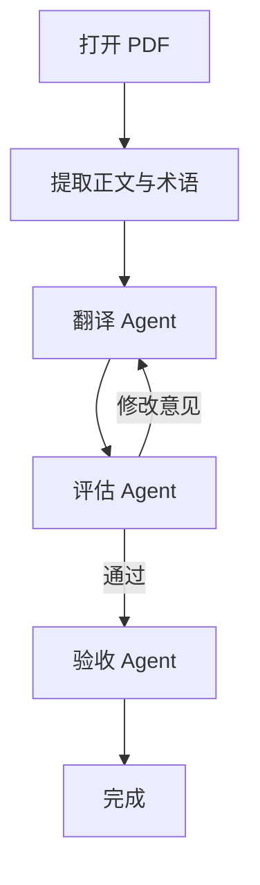

# ReadMaster
reading tool for amateur

ReadMaster 是做的面向初入科研的大学生的 Windows 论文阅读器。中文译文显示在 PDF 正文原来的位置；遇到术语、长句或值得学习的科研表达，点击句块即可查看对应英文，再次点击恢复中文。

## 为什么做这个产品

刚开始读论文时，往往有很多困难：研究背景不熟悉，专业概念需要理解，英语表达又增加了一层阅读负担。读者希望借助中文抓住文章主线，也希望通过英文核对细节，了解论文的写法，逐渐积累本领域的英文科研表达。

原文与译文分开阅读时，两种语言的长度和换行不同，找到同一句话常常需要。注意力不断在“读内容”和“找对应位置”之间切换，容易记住零散句子，却难以连起研究问题、方法、证据和结论。现有的论文阅读器多采用双屏翻译，左边显示原文，右边显示同位置同格式的译文，但是左右两边反复横跳，还是会打断原先阅读体验。对科研小白不友好。

ReadMaster 希望降低这部分定位成本：先用中文保持阅读连续性，在需要时原位查看每句的英文原文，避免了重新阅读一整段英文上下文的时间和注意力成本。


## 从打开 PDF 到验收

下图概括主流程。Agent 是程序调用的不同模型角色；不同角色可以使用同一个配置的模型。



自动检查的当前门槛是：**至少 97% 的评估单元得分严格大于 0.7，全部不低于 0.5，并且没有实质性错误**。

## 设计思路

### 预翻译

预翻译阶段，ReadMaster 提取 PDF 正文及其位置，按句块建立固定编号，保留图表、表格、公式和参考文献原貌。结合术语表与上下文，调用翻译 Agent 分批生成中文译文，校验对应关系后保存并显示在原文位置。

### 为什么选 BabelDOC

[BabelDOC](https://github.com/funstory-ai/BabelDOC) 面向科学论文 PDF 翻译，提供可复用的翻译模板及文档处理能力，适合作为论文场景的基础组件。ReadMaster 当前用其原生模板适配翻译与修订，并自行管理句块编号、上下文、缓存和阅读交互；PDF 解析与阅读页面渲染主要由 PyMuPDF 完成。

底层 PDF 重排集成采用上游推荐的 PDFMathTranslate-next 高层接口。由于依赖版本与阅读器不同，引擎放在独立 Python 环境中，避免互相影响；本项目固定已验证的 BabelDOC 0.5.24，而不是直接追随上游最新接口。

### 为什么组合 COMETKiwi、XCOMET 与 LLM

论文通常没有人工参考译文。[COMETKiwi](https://huggingface.co/Unbabel/wmt22-cometkiwi-da) 可以根据原文和译文进行无参考质量估计；[XCOMET](https://huggingface.co/Unbabel/XCOMET-XL) 能提供疑似错误的文本跨度，让检查有更具体的落点。

ReadMaster 先用 Kiwi 筛查，再对低分、规则异常或前轮阻塞单元调用 XCOMET。数字、公式、引用等程序检查与模型线索交给 LLM，结合全文判断是否真的改变了原意，再提出限定到句块的修订意见。XCOMET 不负责直接撰写修改建议，低分本身也不能证明误译。

### 为什么还要独立验收 Agent

加入独立验收 Agent 的一个设计动机是防范“情景焦虑”：一些模型在接近它们认为的情境极限时，提前结束工作。这里关注的是模型可能过早宣布完成、留下未充分检查的内容，而不是把这种行为理解为模型具有人的情绪。独立验收再次对照全文，旨在补上一道检查，而不只依赖前面角色的完成声明。

另一个需要防范的问题是前轮反馈带来的判断偏移：模型可能反复润色已经正确的译文，也可能沿用上一角色的判断。因此，最终验收使用单独的角色提示词与输入，不接收前轮的评分、通过结论或 XCOMET 建议，以减少过度挑错和结论依赖。

验收通过 **Prompt Engineering** 明确尺度：对照全文，只把有原文证据、影响含义的错误列为阻塞；接受合理同义表达，不为体现独立性而强行找问题。发现实质错误就回到定点修订，再重新评分和检查。

这是一种输入隔离与审校约束，并非已经证明能消除模型焦虑或偏差；相同底层模型仍可能共享盲点。验收提示词见 [readmaster/review_prompts.py](readmaster/review_prompts.py)，完整导出副本见 [prompts/acceptance.txt](prompts/acceptance.txt)。

## 使用与运行

当前面向 Windows x64，支持带文字层的英文 PDF（1–200 页、80 MB 以下）。扫描件 OCR、加密 PDF 暂不支持；复杂版式、极长段落与公式仍可能需要人工核对。

如果使用完整便携客户端，保留其运行目录并启动 `ReadMaster.exe`。需要 Windows WebView2 Runtime；翻译前在 Models 中配置自己的 API，或登录自己的 Codex 账号。当前提供 OpenAI、DeepSeek、GLM API 入口以及 Codex CLI 通道，实际可用模型取决于服务商和账号权限。

开发运行建议使用 Python 3.12，在项目根目录执行：

```powershell
python -m venv .venv
.venv\Scripts\python.exe -m pip install -r requirements.txt
.venv\Scripts\python.exe scripts/setup_babeldoc.py
.venv\Scripts\python.exe scripts/setup_comet.py
```

在 Hugging Face 的两个模型页面分别接受访问条件，并按官方说明配置本机认证；首次使用需下载权重与相关资源，预留数十 GB 磁盘空间和足够内存。上述脚本安装运行环境，不代表模型已下载或账号已获授权。准备后启动：

```powershell
.venv\Scripts\python.exe launcher.py
```

使用 Codex 通道还需自行安装并登录官方 Codex CLI，或提供完整客户端中的对应工具。API 通道需支持本项目使用的结构化输出。模型调用可能消耗额度或产生费用。

## 数据与隐私

文献与译文保存在 `data/documents/`，按 PDF 内容哈希去重；打开历史文献不重复翻译。API 密钥在 Windows 上使用 DPAPI 加密保存，Codex 登录由官方 CLI 管理。本机服务只监听 `127.0.0.1`。

翻译和语义审校会把论文文本、上下文及术语发送给你配置的模型服务；它不是完全离线应用。发布源码时不要加入 `data/`、账号会话、`.env`、构建目录或个人备份。

## 开发入口

| 位置 | 职责 |
| --- | --- |
| `web/` | 阅读界面、查找、中英切换与状态同步 |
| `readmaster/server.py` | 本机接口、翻译调度与持久化 |
| `readmaster/babeldoc_agent.py` | BabelDOC 模板与模型调用适配 |
| `readmaster/quality.py` | 评分、评估、修订和验收循环 |
| `readmaster/review_prompts.py` | 评估与验收提示词 |
| `scripts/`、`tests/` | 环境准备、构建及验证 |

```powershell
.venv\Scripts\python.exe -m unittest discover -s tests -v
```

部分集成测试需要本机服务、模型或测试 PDF，条件不足会跳过。浏览器测试使用 Playwright；可安装该依赖或通过 `READMASTER_PLAYWRIGHT` 指定安装位置，真实论文测试通过 `READMASTER_TEST_PDF` 指定输入。历史接入过程见 [BabelDOC接入记录.md](BabelDOC接入记录.md) 与 [COMET评估接入.md](COMET评估接入.md)，其中的本机验证结果不代表新环境已完成配置。

## 致谢、引用与许可

感谢 [BabelDOC](https://github.com/funstory-ai/BabelDOC)、[PDFMathTranslate-next](https://github.com/PDFMathTranslate/PDFMathTranslate-next)、[PyMuPDF](https://github.com/pymupdf/PyMuPDF)、[COMET](https://github.com/Unbabel/COMET) 与相关依赖的作者。本项目源码采用 [AGPL-3.0](LICENSE)，组件说明见 [THIRD-PARTY-NOTICES.md](THIRD-PARTY-NOTICES.md)。

依据 2026-10-14 查阅的官方说明：

- **BabelDOC**：官方仓库采用 [AGPL-3.0](https://github.com/funstory-ai/BabelDOC/blob/main/LICENSE)。本次查看的 README 未发现单独指定的论文引用格式；仍应保留版权与许可声明，并按适用条款履行分发源码、修改说明及网络交互相关义务，不能只写致谢代替许可要求。
- **COMET**：官方 [Publications](https://github.com/Unbabel/COMET#publications) 明确请求使用者引用相关工作，并注明使用的模型。本项目使用 `Unbabel/wmt22-cometkiwi-da` 与 `Unbabel/XCOMET-XL`，研究报告中应据实列出二者。
- **模型与代码分开看**：COMET 代码是 Apache-2.0，但上述两个模型卡均标注 **CC BY-NC-SA 4.0**，下载前需要接受模型访问条件。遵守署名、非商业和适用的相同方式共享要求；XCOMET 官方明确要求商业服务联系 Unbabel 获取授权。不要把代码许可理解为权重可自由商用。参见 [模型许可说明](https://github.com/Unbabel/COMET/blob/master/LICENSE.models.md)、[Kiwi 模型卡](https://huggingface.co/Unbabel/wmt22-cometkiwi-da)、[XCOMET 模型卡](https://huggingface.co/Unbabel/XCOMET-XL) 与 [CC 许可说明](https://creativecommons.org/licenses/by-nc-sa/4.0/)。

相关论文：

1. Rei et al. (2020). [COMET: A Neural Framework for MT Evaluation](https://aclanthology.org/2020.emnlp-main.213/).
2. Rei et al. (2022). [CometKiwi: IST-Unbabel 2022 Submission for the Quality Estimation Shared Task](https://aclanthology.org/2022.wmt-1.60/).
3. Guerreiro et al. [xCOMET: Transparent Machine Translation Evaluation through Fine-grained Error Detection](https://arxiv.org/abs/2310.10482).

模型评分与自动验收都不能替代科研判断。关键结论、数值、公式和引用仍应回到原文核实。
